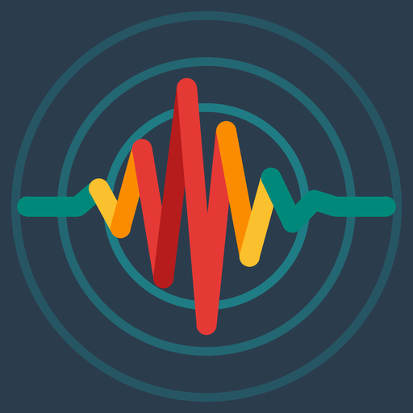
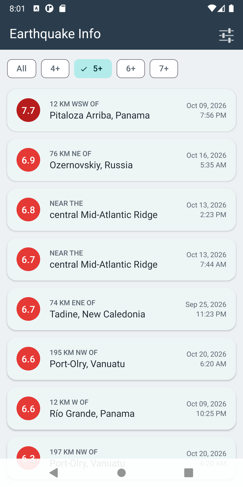
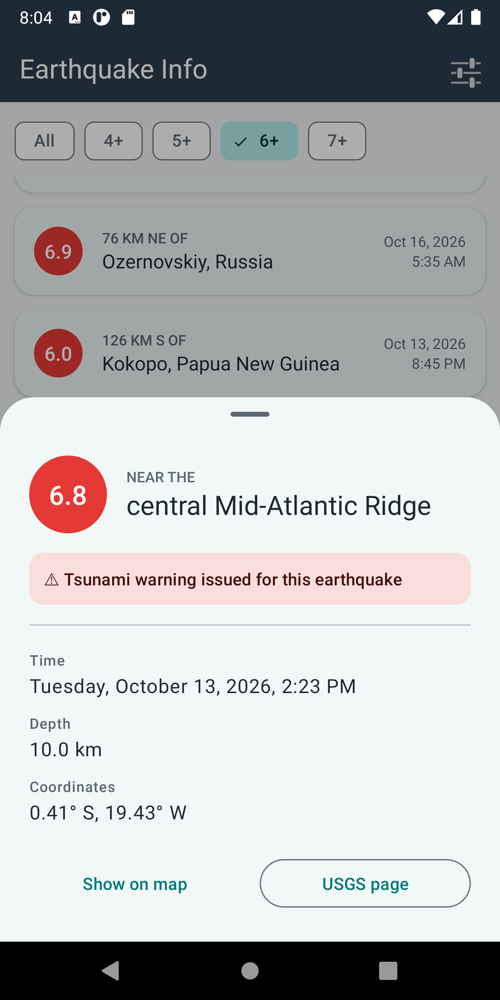
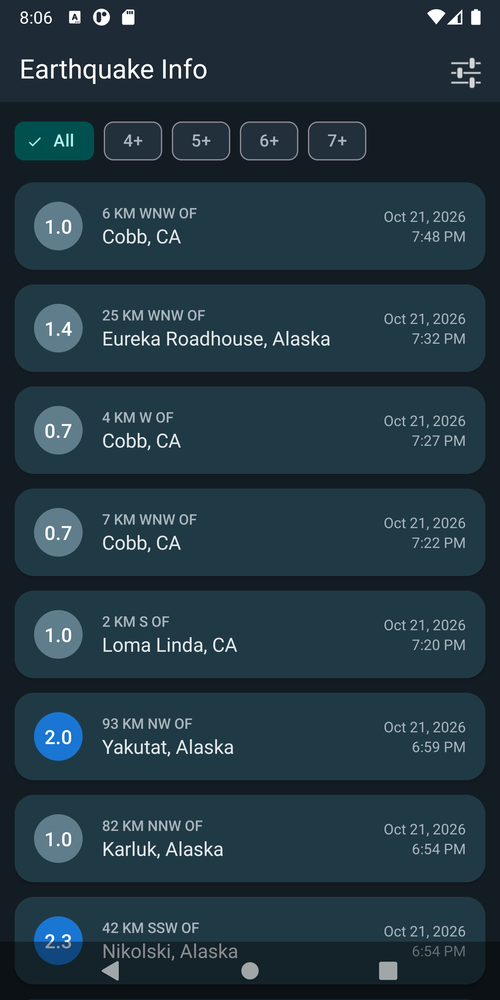
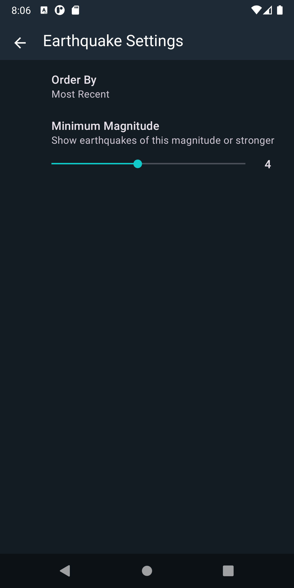
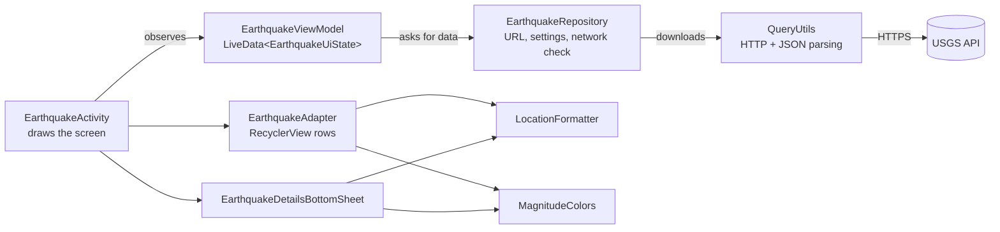

<p align="center">
  
</p>

<h1 align="center">Earthquake Info</h1>

<p align="center">
  An Android app that shows the latest earthquakes around the world, using live data from the
  <a href="https://earthquake.usgs.gov/fdsnws/event/1/">USGS Earthquake API</a>.
</p>

<p align="center">
  
  
  
  
  
</p>

---

## Screenshots

<p align="center">
  
  
  
  
</p>

## Features

- **Latest earthquakes** – the 25 most recent (or strongest) earthquakes from USGS.
- **Color-coded magnitude** – every magnitude has its own color, from grey-blue (weak) to dark purple (10+), with dark text on the light yellow and orange circles for better contrast.
- **Quick filter** – chips above the list (*All, 4+, 5+, 6+, 7+*) change the minimum magnitude with one tap.
- **Details panel** – tapping an earthquake opens a bottom sheet with the exact time, depth, coordinates and a tsunami warning, plus buttons to open the epicenter on a map or the USGS page.
- **Pull to refresh** and a **Retry** button when there is no internet or the server does not answer.
- **Settings** – minimum magnitude slider (0–9) and sort order (by magnitude or most recent).
- **Light and dark theme** – Material 3, follows the system setting.
- **Edge-to-edge** layout for Android 15+.
- **Two languages** – English and Serbian (Cyrillic). Directions are translated too: *"73 km WSW of Rumoi, Japan"* becomes *"73 km ЗЈЗ од Rumoi, Japan"*. Dates and times follow the phone's language and 12/24-hour setting.
- **Adaptive launcher icon** with a monochrome layer for themed icons (Android 13+).

## Architecture

The app follows the **MVVM** pattern recommended by Google:



| Class | Responsibility |
|---|---|
| `EarthquakeActivity` | Main screen. Observes the UI state and only draws it (list, loading indicator, message, chips). |
| `EarthquakeViewModel` | Decides *when* to load, runs the download on a background thread and survives screen rotation. |
| `EarthquakeUiState` | One immutable state of the screen: `LOADING`, `SUCCESS`, `EMPTY`, `NO_INTERNET` or `ERROR`. |
| `EarthquakeRepository` | Builds the request URL from the saved settings and checks the network connection. |
| `QueryUtils` | HTTP request (with timeouts) and parsing of the USGS GeoJSON response. |
| `Earthquake` | Immutable data class: magnitude, place, time, URL, coordinates, depth, tsunami flag. |
| `EarthquakeAdapter` | `ListAdapter` + `DiffUtil` + ViewBinding; only changed rows are redrawn. |
| `LocationFormatter` | Splits and translates the USGS place text; formats coordinates. |
| `MagnitudeColors` | One shared rule for the circle and text colors. |
| `EarthquakeDetailsBottomSheet` | Details panel; opens maps via a `geo:` link with a web fallback. |
| `SettingsActivity` | AndroidX Preference screen with a slider and a list. |

## Tech stack

- **Language:** Java 21
- **UI:** Material Components 3, RecyclerView, SwipeRefreshLayout, BottomSheetDialogFragment, ViewBinding
- **Architecture:** AndroidX ViewModel + LiveData, Repository, `ExecutorService`
- **Settings:** AndroidX Preference (`SeekBarPreference`, `ListPreference`)
- **Networking:** `HttpURLConnection` + `org.json` (no third-party libraries)
- **Build:** Android Gradle Plugin 8.10.1, Gradle 8.11.1, compile/target SDK 36, min SDK 23
- **Tests:** JUnit 4

## Tests

26 local unit tests run on the computer, without a device or internet:

| Test class | Tests | What it checks |
|---|---|---|
| `LocationFormatterTest` | 11 | Splitting and translating places, unusual inputs, coordinates |
| `QueryUtilsTest` | 10 | JSON parsing, missing values, invalid JSON, coordinate order, tsunami flag |
| `EarthquakeUiStateTest` | 5 | Every state carries the right data; the list cannot be changed from outside |

Run them from Android Studio (right-click the `test` folder → *Run Tests*) or from the terminal:

```bash
./gradlew test
```

## Getting started

1. Clone the repository:
   ```bash
   git clone https://github.com/NemanjaAdzic83/earthquakeinfo.git
   ```
2. Open the project in a recent version of **Android Studio** and wait for Gradle sync.
3. Run the app on an emulator or a device with Android 6.0 or newer.

No API key is needed: the USGS API is free and public.

## History

The first version was written in 2022 as a learning project (ListView, `AsyncTaskLoader`, AppCompat theme).
In 2026 it was modernized step by step: new build tools and SDK 36, MVVM with ViewModel and LiveData,
RecyclerView with DiffUtil, Material 3 with dark mode, Serbian translation, unit tests, the details panel,
quick filter chips and a new launcher icon. Every step is a separate commit, so the history shows how the code changed.

## Data source

Earthquake data: [U.S. Geological Survey (USGS) Earthquake Hazards Program](https://earthquake.usgs.gov/).
USGS data is in the public domain.

## Author

**Nemanja Adžić** – [@NemanjaAdzic83](https://github.com/NemanjaAdzic83)
